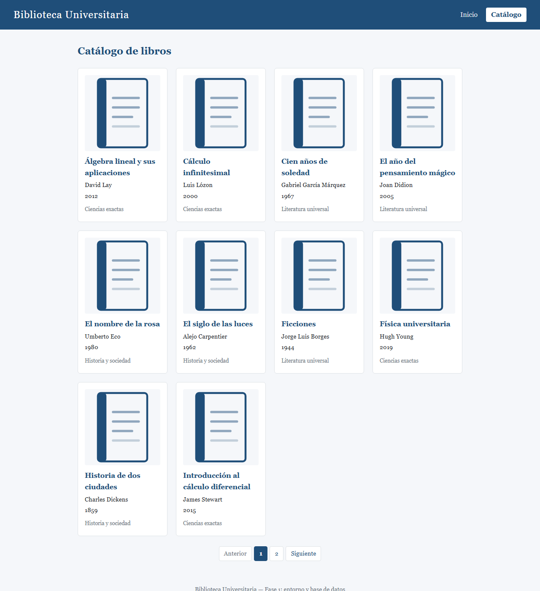
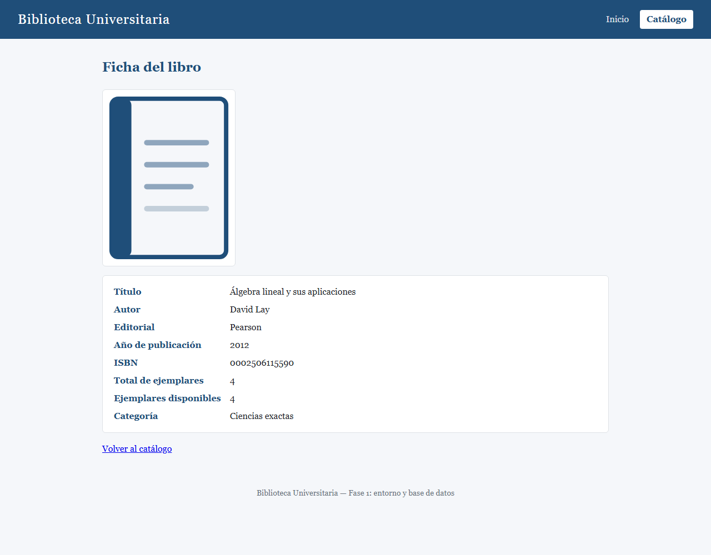
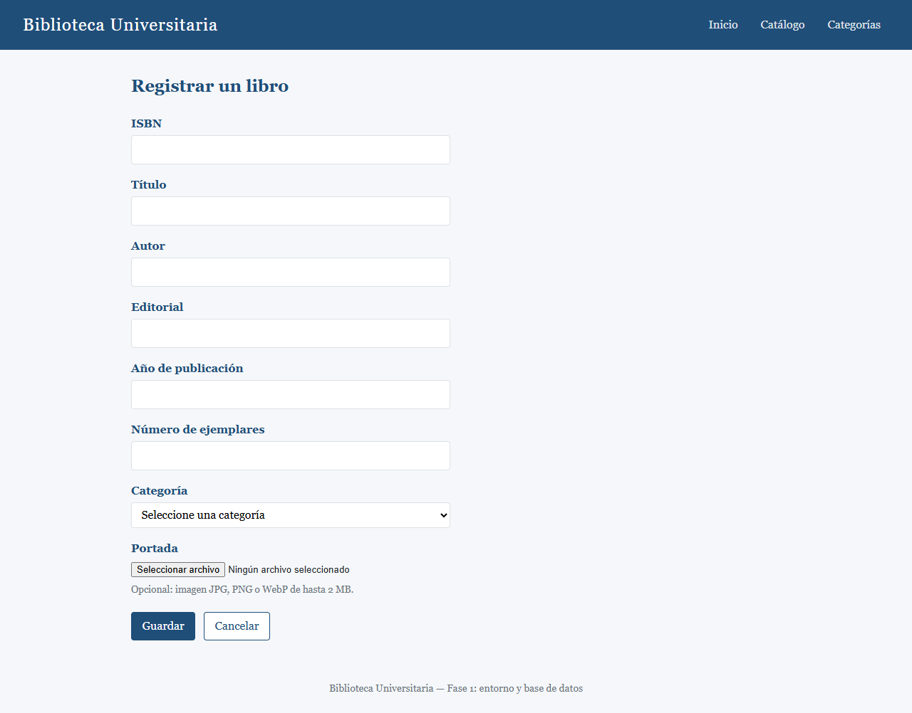
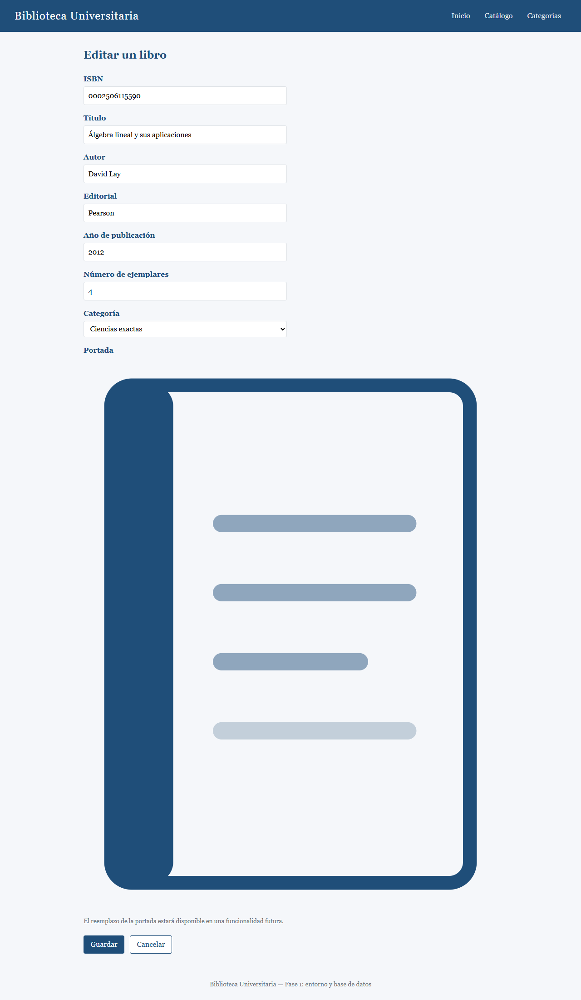
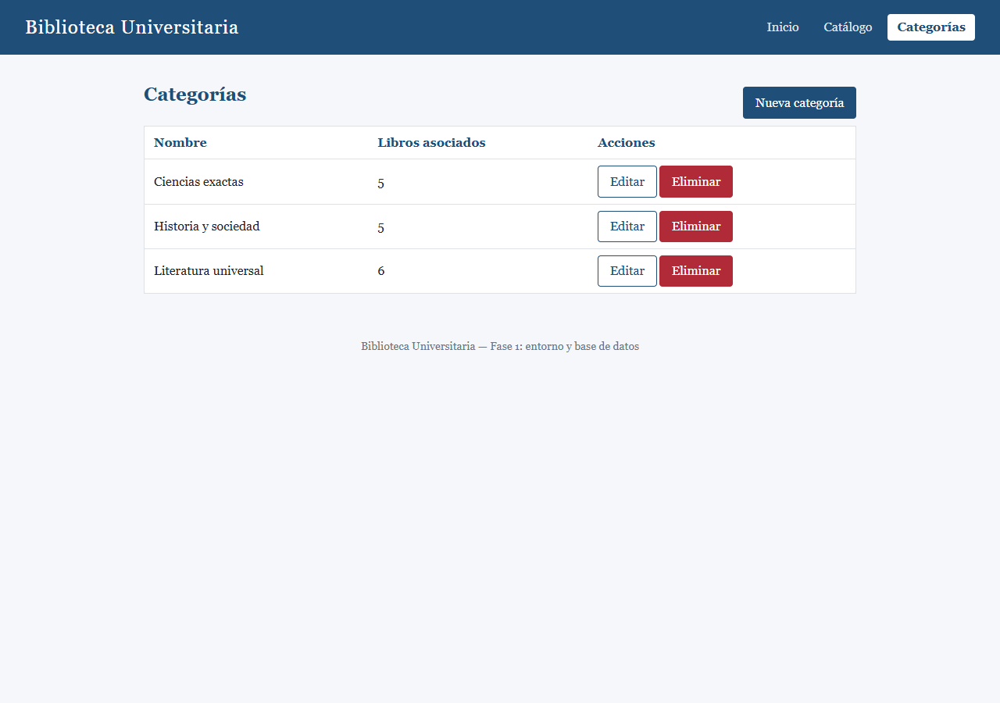
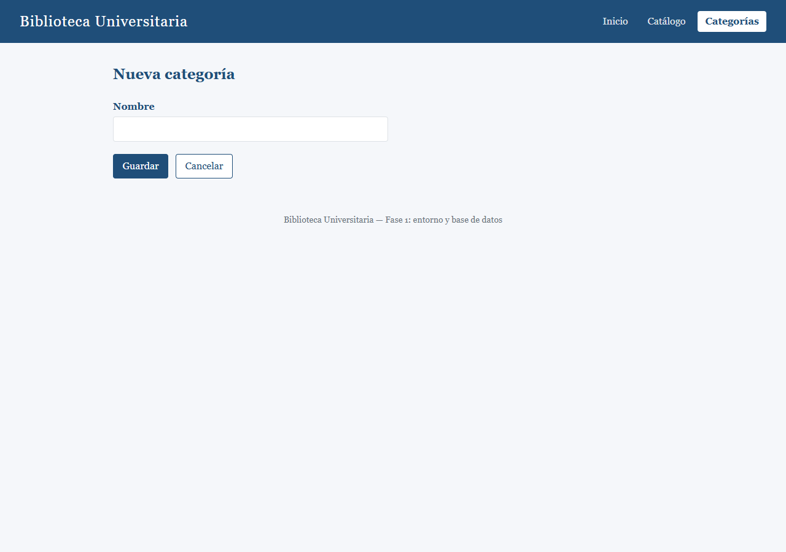
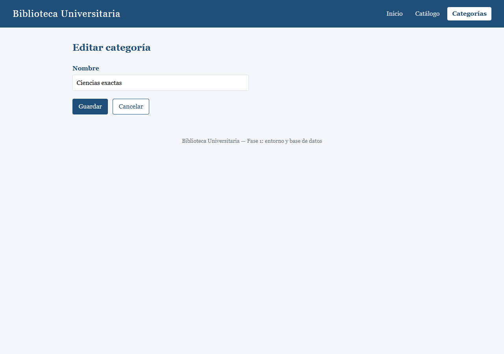

# Biblioteca Universitaria — Gestión de libros y catálogo

Aplicación web local para la gestión de una biblioteca universitaria, construida
con **Laravel 13** (PHP >= 8.3) y una base de datos relacional. La base queda
lista con esquema versionado con migraciones y datos de prueba; sobre ella se
ofrece la consulta del catálogo y el **CRUD de libros y categorías** con
validación y mensajes en español.

## Requisitos previos

| Requisito | Versión mínima |
|---|---|
| PHP | 8.3 (con extensiones `pdo_mysql`, `mbstring`, `openssl`, `curl`, `fileinfo`, `zip`) |
| Composer | 2.x |
| MySQL | 8.x local (gratuito) |
| Git | cualquier versión reciente |

> **Motor de datos**: el motor elegido y documentado es **MySQL 8 local**
> (gratuito y sin servicios de pago). La aplicación es compatible también con
> **MariaDB** (casi idéntica a MySQL: basta con apuntar `DB_HOST`/`DB_PORT` a
> su instalación) y con **PostgreSQL local** (requiere cambiar
> `DB_CONNECTION=pgsql` y el puerto `5432`). El resto de la guía asume MySQL.

## Instalación (una sola vez por entorno)

```bash
composer install                    # 1. dependencias de PHP
cp .env.example .env                # 2. crear el archivo local de configuración
# 3. editar .env y completar los datos de conexión (ver abajo)
php artisan key:generate            # 4. generar la APP_KEY
php artisan migrate --seed          # 5. crear el esquema y cargar los datos de prueba
php artisan storage:link            # 6. enlace simbólico para servir las portadas subidas
```

El comando `php artisan storage:link` crea el enlace
`public/storage` → `storage/app/public`, de modo que los archivos subidos al
disco público (por ejemplo, las portadas de los libros en
`storage/app/public/portadas`) se sirvan por HTTP desde la aplicación. Es
necesario ejecutarlo una sola vez por instalación, después de `key:generate`.

### Configuración de conexión (`.env`)

El archivo `.env` **no se versiona** (está en `.gitignore`); solo se versiona
`.env.example` como plantilla sin secretos. Edita tu `.env` local con los datos
de tu instalación de MySQL:

```dotenv
DB_CONNECTION=mysql
DB_HOST=127.0.0.1
DB_PORT=3306
DB_DATABASE=biblioteca
DB_USERNAME=root
DB_PASSWORD=            # la contraseña de tu usuario local, nunca se versiona
```

### Crear la base de datos

La base de datos debe existir **antes** de ejecutar las migraciones. Crea las
dos bases (desarrollo y pruebas) en tu cliente de MySQL (por ejemplo,
`mysql -u root -p`):

```sql
CREATE DATABASE biblioteca CHARACTER SET utf8mb4 COLLATE utf8mb4_unicode_ci;
CREATE DATABASE biblioteca_test CHARACTER SET utf8mb4 COLLATE utf8mb4_unicode_ci;
```

- `biblioteca`: base de datos de desarrollo (la usa `php artisan migrate --seed`).
- `biblioteca_test`: base de datos dedicada para `php artisan test`
  (configurada en `phpunit.xml`; se recrea automáticamente en cada ejecución).

## Comando de inicio

```bash
php artisan serve
```

La aplicación queda disponible en **http://127.0.0.1:8000**, conectada a la
base de datos. Es el único comando necesario para arrancar una vez instalado.

Si la conexión a la base de datos falla (credenciales incorrectas, motor
apagado o base inexistente), la aplicación **no sirve ninguna vista de datos** y
muestra un aviso en español indicando que hay que revisar la configuración de
conexión en el archivo `.env`. El aviso nunca incluye usuario, contraseña, host
ni SQL.

## Consulta del catálogo

La navegación común (cabecera) incluye los enlaces **«Catálogo»** y
**«Categorías»**, que distinguen visualmente la página activa y funcionan en
todas las vistas, incluidas las de error. La consulta del catálogo ofrece dos
rutas, sin autenticación en esta fase:

| Método y ruta | Nombre | Contenido |
|---|---|---|
| `GET /catalogo` | `catalogo.index` | Listado paginado: 10 libros por página, orden alfabético A–Z por título (ignorando tildes y mayúsculas, con desempate por autor e ISBN), tarjetas completas y clicables con portada o imagen predeterminada |
| `GET /catalogo/{id}` | `catalogo.show` | Ficha del libro con todos sus campos y su categoría |

- Un libro inexistente o una página fuera de rango (`/catalogo?page=999`,
  `page=0`, `page=abc`, …) responden **HTTP 404** con una vista personalizada
  en español («Libro no encontrado» / «Página no válida») y el enlace
  «Volver al catálogo».
- Con el catálogo vacío, la página 1 muestra «No hay libros registrados aún»
  sin tarjetas ni controles de paginación.
- Los libros sin portada muestran la imagen predeterminada del proyecto
  (`public/images/libro-sin-portada.svg`); el orden del listado está fijado
  por una migración de colación (`utf8mb4_0900_ai_ci`, o
  `utf8mb4_unicode_520_ci` en MariaDB) sobre `libros.titulo` y `libros.autor`.

### Capturas

| Listado (`/catalogo`) | Detalle (`/catalogo/{id}`) |
|---|---|
|  |  |

## Gestión de libros y categorías

Además de la consulta, la aplicación permite **crear, editar y eliminar** libros
y categorías desde su propia interfaz (sin autenticación en esta fase). Toda
escritura pasa por un formulario validado en el servidor; los mensajes de error
aparecen **junto al campo** correspondiente y lo escrito se conserva (`old()`).

| Ruta | Nombre | Contenido |
|---|---|---|
| `GET /libros/crear` | `libros.create` | Alta de libro |
| `POST /libros` | `libros.store` | Registro validado |
| `GET /libros/{id}/editar` | `libros.edit` | Edición precargada |
| `PUT /libros/{id}` | `libros.update` | Actualización validada |
| `DELETE /libros/{id}` | `libros.destroy` | Eliminación con confirmación |
| `GET /categorias` | `categorias.index` | Listado con la cantidad de libros asociados |
| `GET /categorias/crear` | `categorias.create` | Alta de categoría |
| `POST /categorias` | `categorias.store` | Registro validado |
| `GET /categorias/{id}/editar` | `categorias.edit` | Edición precargada |
| `PUT /categorias/{id}` | `categorias.update` | Actualización validada |
| `DELETE /categorias/{id}` | `categorias.destroy` | Eliminación con confirmación |

### Reglas de creación y edición de libros

- **ISBN**: obligatorio, exactamente **13 dígitos** sin guiones ni espacios, y
  **único** en toda la base de datos (duplicado → «El ISBN ya está registrado en
  otro libro.»).
- **Año de publicación**: obligatorio y dentro del rango **1900 … año actual**.
- **Número de ejemplares**: entero ≥ 1. En edición no puede bajar por debajo de
  los **préstamos activos** del libro («El número de ejemplares no puede ser
  inferior a los préstamos activos (n).»).
- **Categoría**: obligatoria; el formulario solo ofrece categorías existentes.
- **Portada** (opcional): imagen JPG, PNG o WebP de hasta 2 MB. Requiere haber
  ejecutado `php artisan storage:link` (ver «Instalación»). Al editar sin
  enviar archivo, la portada existente **queda intacta**.
- **Disponibilidad derivada**: el formulario **no** contiene un campo
  «ejemplares disponibles»; el servidor lo calcula siempre como
  `ejemplares_totales − préstamos activos` en cada guardado.

### Gestión de categorías y unicidad normalizada

El nombre de categoría es **único ignorando mayúsculas, acentos y espacios**:
con «Matemáticas» dada de alta, crear «matematicas », «MATEMATICAS» o
«Matematicas» se rechaza con «Ese nombre de categoría ya existe.» junto al
campo, y lo mismo al editar **otra** categoría hacia alguna de esas variantes
(editar «Matemáticas» conservando su propio nombre sí es válido). La garantía
tiene tres capas independientes:

1. Validación `unique` en el formulario (primer aviso, junto al campo).
2. Recorte de espacios (`trim`) antes de validar y al persistir.
3. Collation de la base de datos (`utf8mb4_0900_ai_ci` en `categorias.nombre`,
   con variantes `utf8mb4_uca1400_ai_ci` en MariaDB 10.11+ y
   `utf8mb4_unicode_520_ci` en MySQL 5.7) más el índice `UNIQUE`, de modo que
   incluso dos altas simultáneas por fuera de la interfaz colisionan en la
   base de datos.

### Eliminaciones con confirmación

Toda eliminación se envía mediante **`DELETE`** (nunca `GET`), con un
`confirm()` en el navegador y las tres capas de protección: comprobación
previa, respaldo `RESTRICT` de la base de datos y confirmación del usuario.

| Intento | Resultado | Aviso |
|---|---|---|
| Eliminar un libro con préstamos | Bloqueado | «El libro tiene préstamos registrados y no puede eliminarse.» |
| Eliminar una categoría con libros | Bloqueado | «La categoría tiene libros asociados y no puede eliminarse.» |
| Eliminar un libro sin préstamos | Confirmación y borrado | «Libro eliminado correctamente.» |
| Eliminar una categoría sin libros | Confirmación y borrado | «Categoría eliminada correctamente.» |

### Capturas de gestión

| Alta de libro (`/libros/crear`) | Edición de libro (`/libros/{id}/editar`) |
|---|---|
|  |  |

| Listado (`/categorias`) | Alta / Edición de categoría |
|---|---|
|  |   |

## Verificación

```bash
php artisan migrate:status   # migraciones ejecutadas (100 % «Ran»)
php artisan migrate:fresh --seed   # rehacer el entorno completo
php artisan test             # suite de pruebas (verde)
```

## Diagrama entidad-relación

```text
categorias (1) ──────< (N) libros (1) ──────< (N) prestamos
   nombre UNIQUE           isbn UNIQUE            estado: activo|devuelto|vencido
                         FK categoria_id            FK libro_id → libros
                         → categorias (RESTRICT)    (RESTRICT)
```

- **categorias**: `nombre` único (`varchar(100)`).
- **libros**: `isbn` único de 13 dígitos, ejemplares totales/disponibles,
  `portada` opcional (`NULL` = imagen predeterminada), pertenece a exactamente
  una categoría.
- **prestamos**: estudiante, carnet, fechas de préstamo/devolución prevista y
  real, y estado (`activo`, `devuelto` o `vencido`); pertenece a exactamente un
  libro.

El esquema se crea **exclusivamente con migraciones** versionadas en
`database/migrations/`; nunca con SQL manual.

Los datos de prueba (`php artisan migrate:fresh --seed`) cargan 3 categorías,
16 libros y 3 préstamos (uno por estado), manteniendo siempre la coherencia
`ejemplares_disponibles = ejemplares_totales − ejemplares en préstamos activos`.

## Eliminación de registros relacionados

La eliminación de un registro con hijos está **bloqueada** mientras existan
registros relacionados (comprobación previa en la aplicación y claves foráneas
`ON DELETE RESTRICT` en la base de datos). El detalle de los avisos y de las
capas de confirmación está en «Eliminaciones con confirmación», más arriba.

## Estructura del proyecto

```text
app/Http/Controllers/   # CatalogoController, LibroController, CategoriaController
app/Http/Requests/      # LibroStoreRequest, LibroUpdateRequest, CategoriaStoreRequest…
app/Models/             # Categoría, Libro y Prestamo (Eloquent)
app/Services/           # EliminacionService (comprobación previa de borrado)
app/Exceptions/         # FalloConexion (aviso en español ante error de BD)
lang/es/                # mensajes de validación en español
database/migrations/    # única fuente del esquema
database/factories/     # datos de prueba deterministas
database/seeders/       # CatalogoSeeder (3 categorías, 16 libros, 3 préstamos)
resources/views/        # layout común, catálogo, libros, categorías y errores
tests/Feature/          # pruebas de catálogo, gestión y casos heredados de la Fase 1
```
