# Biblioteca Universitaria — Gestión de libros, catálogo y préstamos

Aplicación web local para la gestión de una biblioteca universitaria, construida
con **Laravel 13** (PHP >= 8.3) y una base de datos relacional. La base queda
lista con esquema versionado con migraciones y datos de prueba; sobre ella se
ofrece la consulta del catálogo, el **CRUD de libros y categorías**, la
**gestión de portadas de los libros**, el **registro, consulta y devolución de
préstamos** y un **panel de indicadores de solo consulta**, con validación y
mensajes en español.

## Requisitos previos

| Requisito | Versión mínima |
|---|---|
| PHP | 8.3 (con extensiones `pdo_mysql`, `mbstring`, `openssl`, `curl`, `fileinfo`, `zip`) |
| Composer | 2.x |
| MySQL | 8.x local (gratuito) |
| Git | cualquier versión reciente |

> **Motor de datos**: el motor elegido y documentado es **MySQL 8 local**
> (gratuito y sin servicios de pago). La aplicación es compatible también con
> **MariaDB** (casi idéntica a MySQL: basta con apuntar `DB_HOST`/`DB_PORT` a
> su instalación) y con **PostgreSQL local** (requiere cambiar
> `DB_CONNECTION=pgsql` y el puerto `5432`). El resto de la guía asume MySQL.

> **Subida de portadas**: PHP necesita un directorio temporal escribible para recibir los archivos. Si `php -i` muestra `upload_tmp_dir => no value` y el sistema no puede escribir en su carpeta temporal, la subida de portadas falla con una página en blanco. Defina en `php.ini` una carpeta a la que el usuario pueda escribir, por ejemplo `upload_tmp_dir = "C:/Users/<usuario>/AppData/Local/Temp/php-uploads"`, cree esa carpeta y reinicie el servidor.

## Instalación (una sola vez por entorno)

```bash
composer install                    # 1. dependencias de PHP
cp .env.example .env                # 2. crear el archivo local de configuración
# 3. editar .env y completar los datos de conexión (ver abajo)
php artisan key:generate            # 4. generar la APP_KEY
php artisan migrate --seed          # 5. crear el esquema y cargar los datos de prueba
```

**No se requiere `php artisan storage:link`**: las portadas se guardan en
`storage/app/public/portadas` pero se sirven por la ruta controlada
`GET /portadas/{id}` (ver «Gestión de portadas»), de modo que el enlace
simbólico `public/storage` no se usa en ningún punto de la aplicación.

### Configuración de conexión (`.env`)

El archivo `.env` **no se versiona** (está en `.gitignore`); solo se versiona
`.env.example` como plantilla sin secretos. Edita tu `.env` local con los datos
de tu instalación de MySQL:

```dotenv
DB_CONNECTION=mysql
DB_HOST=127.0.0.1
DB_PORT=3306
DB_DATABASE=biblioteca
DB_USERNAME=root
DB_PASSWORD=            # la contraseña de tu usuario local, nunca se versiona
```

### Crear la base de datos

La base de datos debe existir **antes** de ejecutar las migraciones. Crea las
dos bases (desarrollo y pruebas) en tu cliente de MySQL (por ejemplo,
`mysql -u root -p`):

```sql
CREATE DATABASE biblioteca CHARACTER SET utf8mb4 COLLATE utf8mb4_unicode_ci;
CREATE DATABASE biblioteca_test CHARACTER SET utf8mb4 COLLATE utf8mb4_unicode_ci;
```

- `biblioteca`: base de datos de desarrollo (la usa `php artisan migrate --seed`).
- `biblioteca_test`: base de datos dedicada para `php artisan test`
  (configurada en `phpunit.xml`; se recrea automáticamente en cada ejecución).

## Comando de inicio

```bash
php artisan serve
```

La aplicación queda disponible en **http://127.0.0.1:8000**, conectada a la
base de datos. Es el único comando necesario para arrancar una vez instalado.

Si la conexión a la base de datos falla (credenciales incorrectas, motor
apagado o base inexistente), la aplicación **no sirve ninguna vista de datos** y
muestra un aviso en español indicando que hay que revisar la configuración de
conexión en el archivo `.env`. El aviso nunca incluye usuario, contraseña, host
ni SQL.

## Interfaz común, accesibilidad y tamaños de pantalla

Todas las vistas comparten una sola estructura (`resources/views/layouts/app.blade.php`):
cabecera con título y navegación, bloque de sesión, región de mensajes, contenido
y pie idénticos. La página activa se distingue con `aria-current="page"`, cada
vista tiene un único `<h1>` y `lang="es"`, y los mensajes de error se muestran
junto al campo con `aria-invalid` y `aria-describedby`.

**La interfaz se construye con CSS propio sin frameworks CSS**: las reglas viven
en `public/css/app.css` (layout, foco visible y contraste ≥ 4,5:1) y en los
bloques `<style>` específicos de alguna vista heredada. No se usa Tailwind,
Bootstrap ni ninguna otra biblioteca de estilos; el JavaScript es nativo
(`public/js/app.js` y `public/js/busqueda-catalogo.js`), sin build ni dependencias
de frontend.

Los estilos responsive cubren tres rangos verificados:

| Rango | Tamaño de referencia | Comportamiento |
|---|---|---|
| `≤ 640 px` | 360 × 640 (teléfono) | Una columna, formularios apilados, tablas con desplazamiento propio |
| `641–1023 px` | 768 × 1024 (tableta) | Rejilla intermedia y navegación legible |
| `≥ 1024 px` | Escritorio | Diseño amplio, sin cambios respecto a la vista original |

### Capturas de los tres tamaños

| 360 × 640 (teléfono) | 768 × 1024 (tableta) |
|---|---|
| 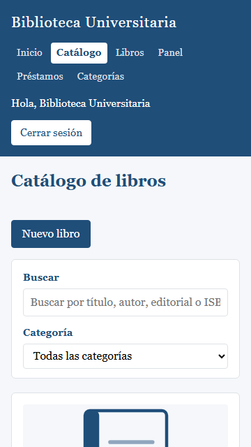 | 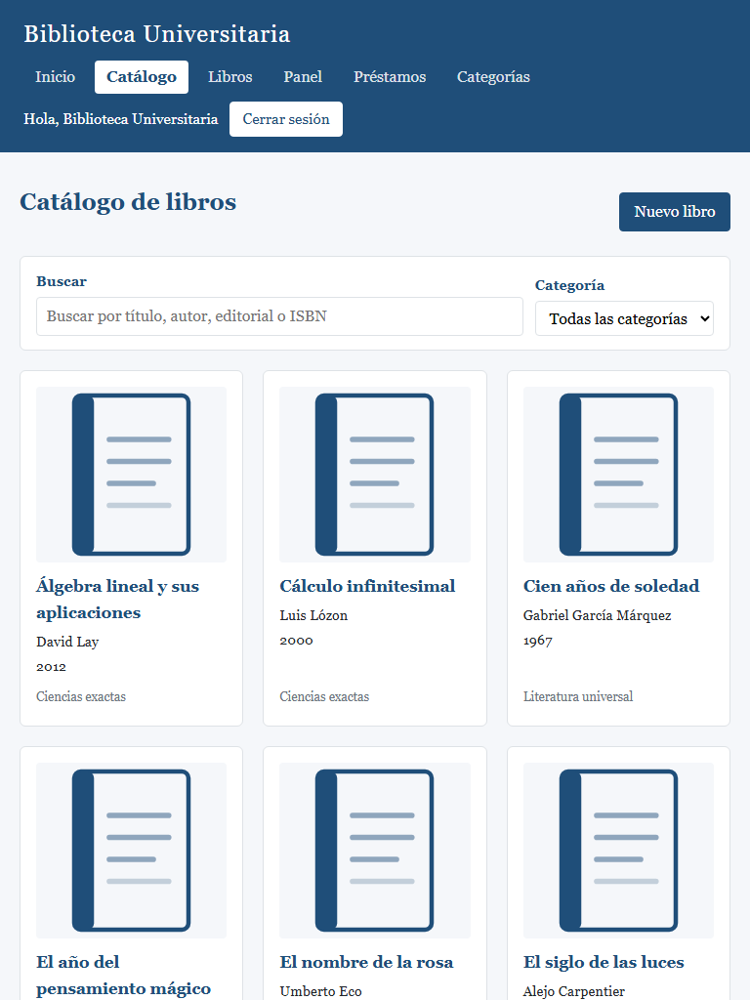 |

| ≥ 1024 px (escritorio) |
|---|
| 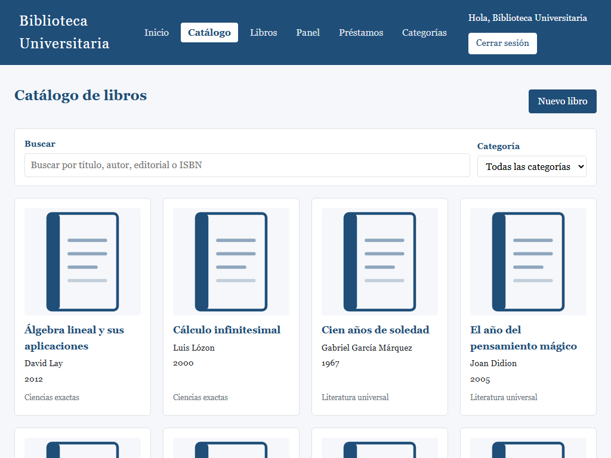 |

## Inicio de sesión y seguridad transversal

Todas las rutas de negocio exigen sesión iniciada; solo `GET /login`,
`POST /login` y la entrega controlada de portadas (`GET /portadas/{id}`, que
responde `401` en español sin sesión) quedan fuera del middleware `auth`.

| Aspecto | Comportamiento |
|---|---|
| Acceso | Sin sesión, cualquier vista o escritura redirige a `/login` con «Inicie sesión para continuar.» y no ejecuta la operación |
| Credenciales | `UserSeeder` crea la cuenta de prueba con contraseña hasheada (`Hash::make`); la contraseña se lee de `USUARIO_SEMILLA_PASSWORD` en el entorno, nunca del repositorio |
| Fallo de login | Cinco intentos fallidos seguidos muestran siempre el mismo mensaje, «Correo o contraseña incorrectos.», sin bloqueo, espera ni pistas sobre si la cuenta existe |
| Sesión | Caduca tras **2 horas de inactividad** (`SESSION_LIFETIME=120` y comprobación en servidor); entonces «Su sesión expiró. Inicie sesión de nuevo.» y la operación no se procesa |
| CSRF | Todos los formularios incluyen `@csrf`; un token ausente o manipulado redirige de vuelta sin guardar nada y muestra «Su sesión expiró o el formulario ya no es válido. Actualice la página e inténtelo de nuevo.», conservando lo introducido |
| Escapado | Toda salida se renderiza con `{{ }}` (no `{!! !!}` con datos), de modo que `<script>` y `' OR 1=1 --` aparecen como texto literal |
| Eliminaciones | Solo por `DELETE`, con `@csrf`, `@method('DELETE')` y `confirm()` previo en español; un `GET` a esas URL responde `405` y no borra nada |
| Validación | Form Requests y mensajes en `lang/es/`; errores junto al campo, valores conservados con `old()` y `aria-*` para lectores de pantalla |

### Captura del inicio de sesión

| Formulario de acceso (`/login`) |
|---|
| 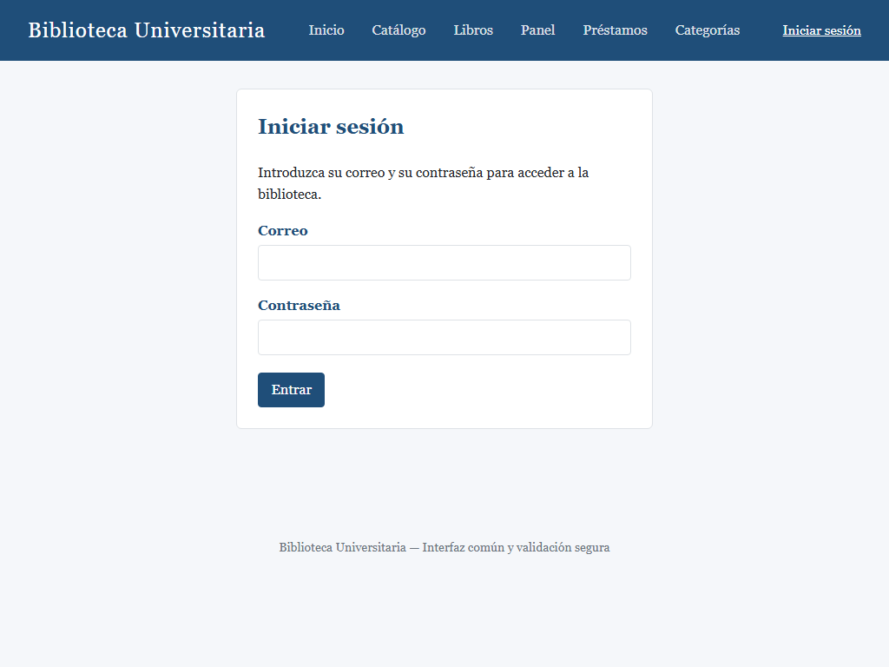 |

## Consulta del catálogo

La navegación común (cabecera) incluye los enlaces **«Catálogo»**,
**«Panel»**, **«Préstamos»** y **«Categorías»**, que distinguen visualmente la página activa
y funcionan en todas las vistas. La consulta del catálogo ofrece dos rutas
(protegidas por sesión; ver «Inicio de sesión y seguridad transversal»):

| Método y ruta | Nombre | Contenido |
|---|---|---|
| `GET /catalogo` | `catalogo.index` | Listado paginado: 10 libros por página, orden alfabético A–Z por título (ignorando tildes y mayúsculas, con desempate por autor e ISBN), tarjetas completas y clicables con portada o imagen predeterminada |
| `GET /catalogo/{id}` | `catalogo.show` | Ficha del libro con todos sus campos y su categoría |

- Un libro inexistente o una página fuera de rango (`/catalogo?page=999`,
  `page=0`, `page=abc`, …) responden **HTTP 404** con una vista personalizada
  en español («Libro no encontrado» / «Página no válida») y el enlace
  «Volver al catálogo».
- Con el catálogo vacío, la página 1 muestra «No hay libros registrados aún»
  sin tarjetas ni controles de paginación.
- Los libros sin portada muestran la imagen predeterminada del proyecto
  (`public/images/libro-sin-portada.svg`); el orden del listado está fijado
  por una migración de colación (`utf8mb4_0900_ai_ci`, o
  `utf8mb4_unicode_520_ci` en MariaDB) sobre `libros.titulo` y `libros.autor`.

### Capturas

| Listado (`/catalogo`) | Detalle (`/catalogo/{id}`) |
|---|---|
| 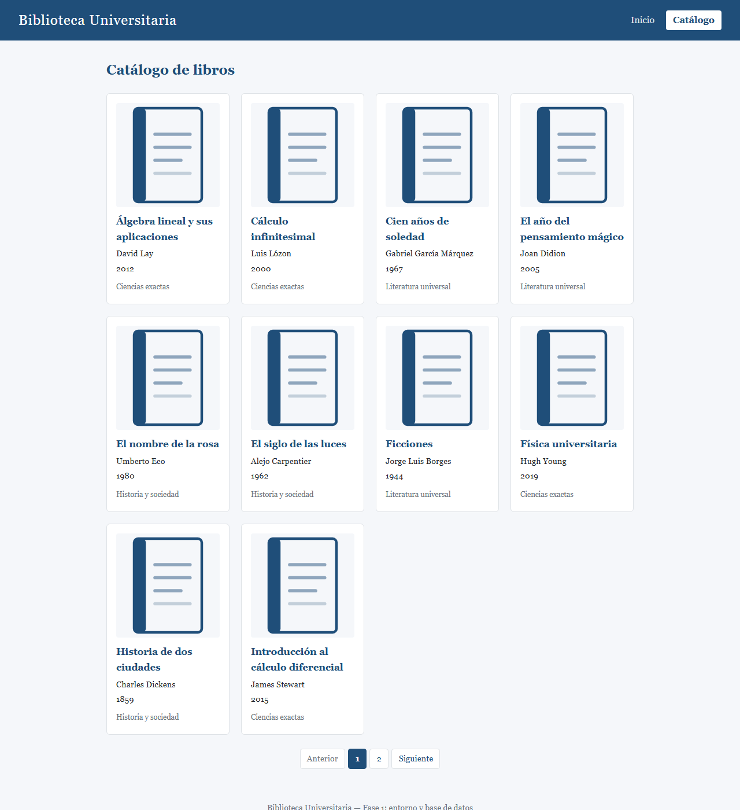 | 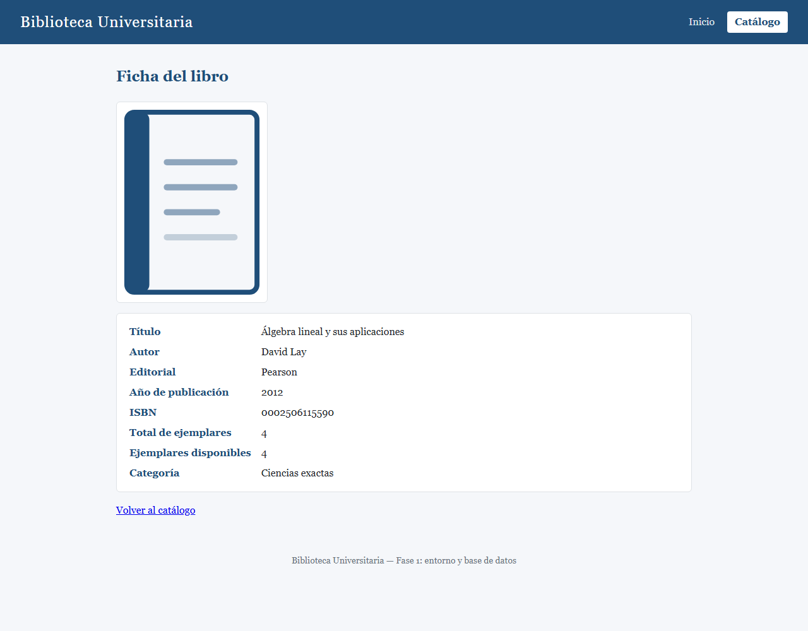 |

## Búsqueda o filtro del catálogo

El listado `GET /catalogo` admite dos criterios de consulta **sobre la misma
ruta** (sin rutas ni endpoints nuevos), combinables entre sí:

| Parámetro | Efecto |
|---|---|
| `q` | Texto libre con coincidencia que **contiene** contra título, autor, editorial e ISBN (regla OR entre los cuatro campos); el texto se recorta y sus comodines `%`/`_` se buscan literalmente |
| `categoria` | Identificador entero existente: filtro **exacto** sobre `categoria_id`; cualquier valor inválido (`abc`, `0`, `-3`, `1,5`, inexistente…) se ignora y no restringe el listado |

- **Regla Y**: con ambos criterios, solo se muestran los libros que cumplen los
  dos a la vez (`/catalogo?q=…&categoria=…`).
- **Sin distinción de mayúsculas ni acentos** en los cuatro campos: una
  migración de colación fija `libros.editorial` con la misma familia que
  `titulo` y `autor` (`utf8mb4_0900_ai_ci`, o `utf8mb4_unicode_520_ci` en
  MariaDB), de modo que «algebra» encuentra «Álgebra lineal».
- **Filtrado automático con debounce**: `public/js/busqueda-catalogo.js`
  (JavaScript nativo, sin frameworks ni build) envía el texto **300 ms**
  después de dejar de teclear —una sola petición en escritura rápida, con el
  último texto como determinante— y envía el desplegable de categoría en cuanto
  cambia. Cada criterio reinicia la paginación (el formulario nunca envía
  `page`) y el foco vuelve al campo con el cursor al final tras la recarga.
  **Sin JavaScript** la función degradada sigue operativa: «Enter» envía el
  formulario (el botón se oculta con CSS, nunca con el atributo `hidden`) y el
  desplegable filtra de forma nativa.
- **Enlace «Limpiar»**: visible solo con al menos un criterio activo; vuelve a
  `/catalogo` sin parámetros (campo vacío y «Todas las categorías»).
- **Estados vacíos diferenciados**:

  | Situación | Mensaje |
  |---|---|
  | Criterio activo y cero resultados | «No se encontraron libros que coincidan con la búsqueda» (sin tarjetas ni paginación, criterios visibles en la barra) |
  | Sin criterio y catálogo vacío | «No hay libros registrados aún» (mensaje heredado de Fase 1) |

- **Paginación filtrada**: 10 libros por página sobre el conjunto filtrado; los
  enlaces conservan `q` y `categoria` (`withQueryString`) y una página fuera de
  rango —evaluada sobre el total filtrado— responde 404 «Página no válida».

## Gestión de libros y categorías

Además de la consulta, la aplicación permite **crear, editar y eliminar** libros
y categorías desde su propia interfaz (con sesión iniciada). Toda escritura pasa
por un formulario validado en el servidor; los mensajes de error aparecen
**junto al campo** correspondiente y lo escrito se conserva (`old()`).

| Ruta | Nombre | Contenido |
|---|---|---|
| `GET /libros/crear` | `libros.create` | Alta de libro |
| `POST /libros` | `libros.store` | Registro validado |
| `GET /libros/{id}/editar` | `libros.edit` | Edición precargada |
| `PUT /libros/{id}` | `libros.update` | Actualización validada |
| `DELETE /libros/{id}` | `libros.destroy` | Eliminación con confirmación |
| `GET /categorias` | `categorias.index` | Listado con la cantidad de libros asociados |
| `GET /categorias/crear` | `categorias.create` | Alta de categoría |
| `POST /categorias` | `categorias.store` | Registro validado |
| `GET /categorias/{id}/editar` | `categorias.edit` | Edición precargada |
| `PUT /categorias/{id}` | `categorias.update` | Actualización validada |
| `DELETE /categorias/{id}` | `categorias.destroy` | Eliminación con confirmación |

### Reglas de creación y edición de libros

- **ISBN**: obligatorio, exactamente **13 dígitos** sin guiones ni espacios, y
  **único** en toda la base de datos (duplicado → «El ISBN ya está registrado en
  otro libro.»).
- **Año de publicación**: obligatorio y dentro del rango **1900 … año actual**.
- **Número de ejemplares**: entero ≥ 1. En edición no puede bajar por debajo de
  los **préstamos activos** del libro («El número de ejemplares no puede ser
  inferior a los préstamos activos (n).»).
- **Categoría**: obligatoria; el formulario solo ofrece categorías existentes.
- **Portada** (opcional): imagen JPG, PNG o WebP de hasta 2 MB inclusive.
  Se asocia, reemplaza o elimina **solo desde el formulario de edición**
  (ver «Gestión de portadas»). Al editar sin enviar archivo, la portada
  existente **queda intacta**.
- **Disponibilidad derivada**: el formulario **no** contiene un campo
  «ejemplares disponibles»; el servidor lo calcula siempre como
  `ejemplares_totales − préstamos activos` en cada guardado.

### Gestión de categorías y unicidad normalizada

El nombre de categoría es **único ignorando mayúsculas, acentos y espacios**:
con «Matemáticas» dada de alta, crear «matematicas », «MATEMATICAS» o
«Matematicas» se rechaza con «Ese nombre de categoría ya existe.» junto al
campo, y lo mismo al editar **otra** categoría hacia alguna de esas variantes
(editar «Matemáticas» conservando su propio nombre sí es válido). La garantía
tiene tres capas independientes:

1. Validación `unique` en el formulario (primer aviso, junto al campo).
2. Recorte de espacios (`trim`) antes de validar y al persistir.
3. Collation de la base de datos (`utf8mb4_0900_ai_ci` en `categorias.nombre`,
   con variantes `utf8mb4_uca1400_ai_ci` en MariaDB 10.11+ y
   `utf8mb4_unicode_520_ci` en MySQL 5.7) más el índice `UNIQUE`, de modo que
   incluso dos altas simultáneas por fuera de la interfaz colisionan en la
   base de datos.

### Eliminaciones con confirmación

Toda eliminación se envía mediante **`DELETE`** (nunca `GET`), con un
`confirm()` en el navegador y las tres capas de protección: comprobación
previa, respaldo `RESTRICT` de la base de datos y confirmación del usuario.

| Intento | Resultado | Aviso |
|---|---|---|
| Eliminar un libro con préstamos | Bloqueado | «El libro tiene préstamos registrados y no puede eliminarse.» |
| Eliminar una categoría con libros | Bloqueado | «La categoría tiene libros asociados y no puede eliminarse.» |
| Eliminar un libro sin préstamos | Confirmación y borrado | «Libro eliminado correctamente.» |
| Eliminar una categoría sin libros | Confirmación y borrado | «Categoría eliminada correctamente.» |

### Capturas de gestión

| Alta de libro (`/libros/crear`) | Edición de libro (`/libros/{id}/editar`) |
|---|---|
| 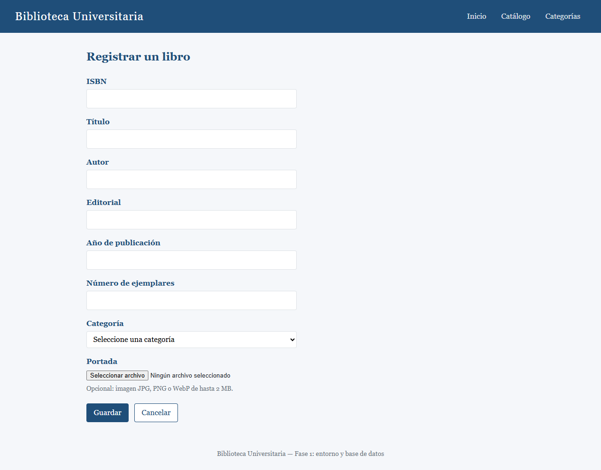 | 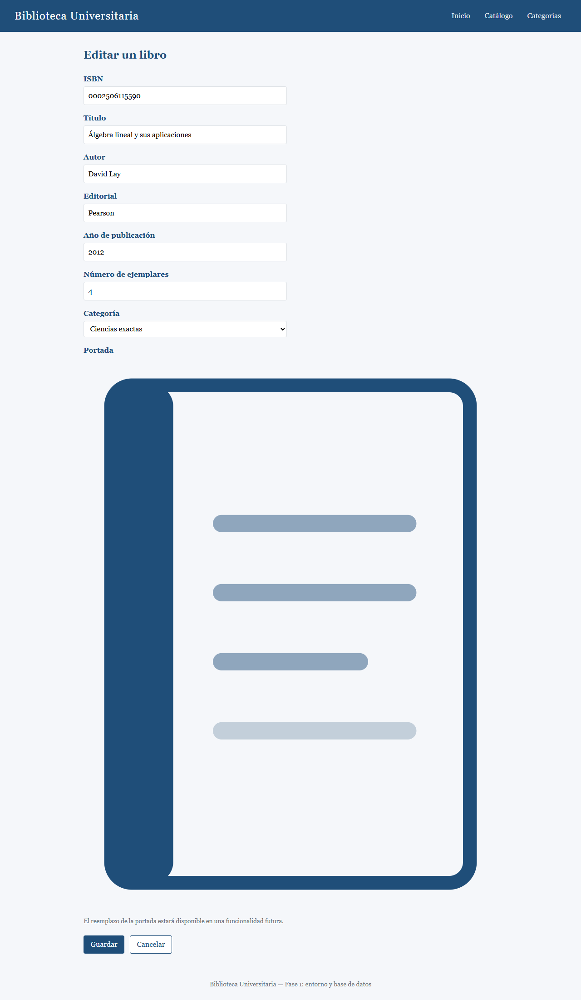 |

| Listado (`/categorias`) | Alta / Edición de categoría |
|---|---|
| 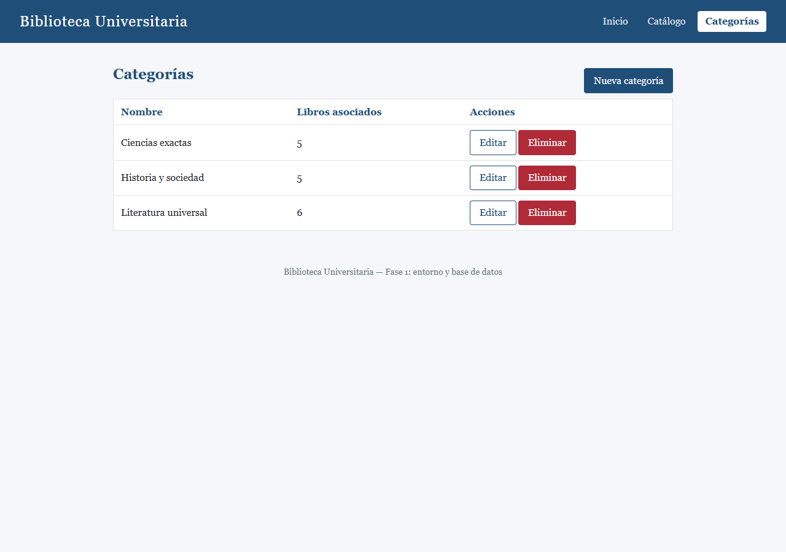 | 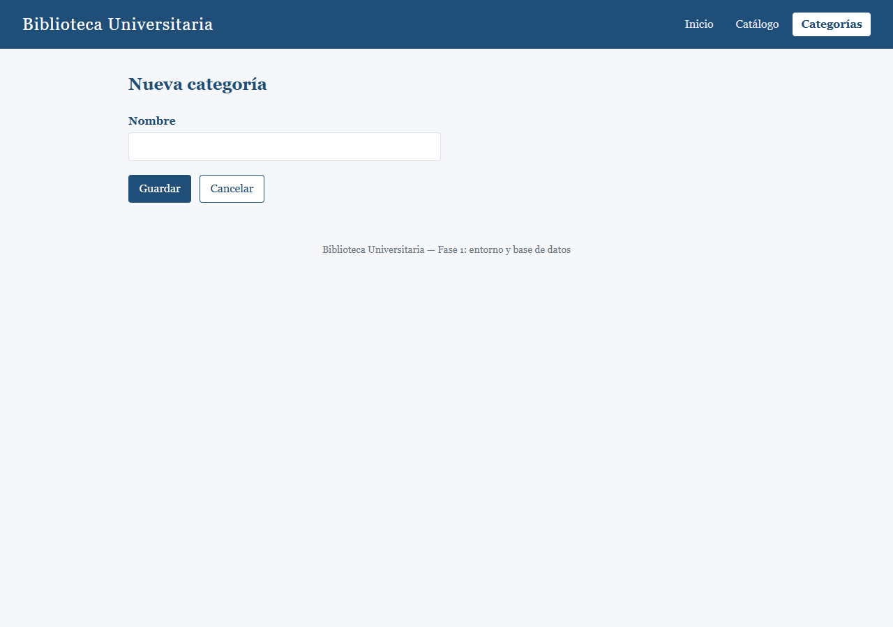 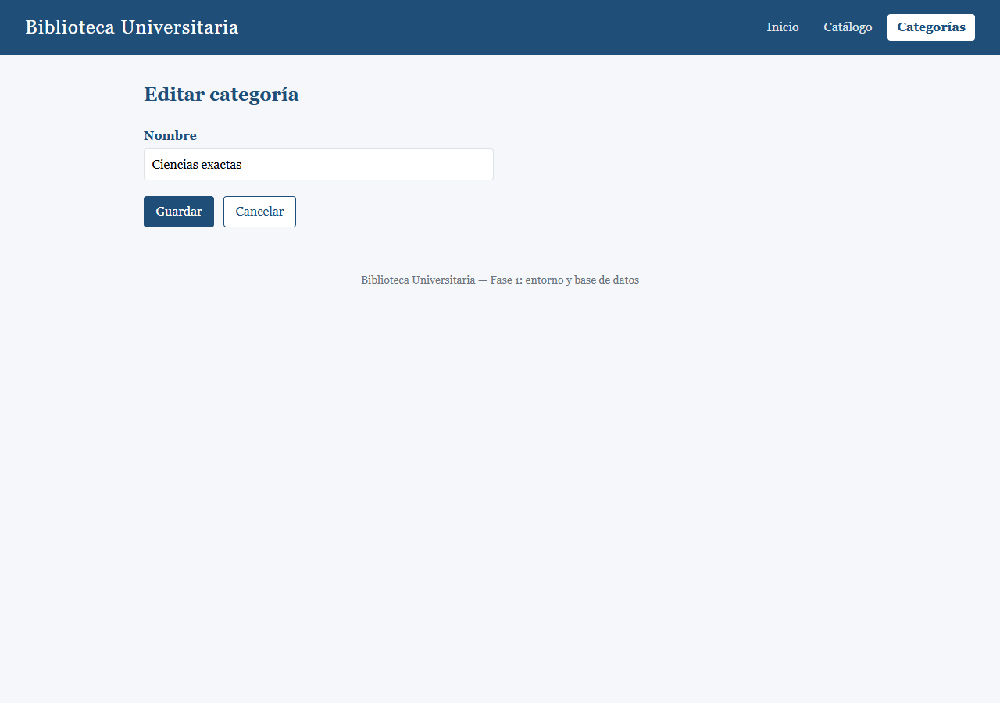 |

## Gestión de portadas

Los libros pueden llevar una imagen de portada, que se asocia, reemplaza y
elimina **exclusivamente desde el formulario de edición del libro**
(`/libros/{id}/editar`): ni el catálogo ni la ficha ofrecen controles de
portada. Cada archivo vive en el directorio propio
`storage/app/public/portadas/{id}/` (exactamente un archivo por libro) y
`libros.portada` guarda su ruta.

| Regla | Detalle |
|---|---|
| Formatos aceptados | **JPG, PNG y WebP**; cualquier otro archivo (GIF, SVG, TIFF o contenido que no sea imagen) se rechaza con «La portada debe ser una imagen JPG, PNG o WebP.» junto al campo |
| Límite de tamaño | **2 MB inclusive** (2 097 152 bytes exactos se acepta); por encima → «La portada no puede superar los 2 MB.» junto al campo |
| Asociar / reemplazar | Con un archivo elegido en el campo «Portada», el botón «Guardar» de la edición ejecuta la transición y muestra «Portada actualizada correctamente.»; al reemplazar, el archivo anterior se elimina y solo queda el nuevo (cero huérfanos) |
| Editar sin archivo | La portada existente **queda intacta**: guardar el formulario nunca la borra de paso |
| Eliminar | Botón «Eliminar portada» de la edición (solo visible si hay portada) con confirmación nativa «¿Seguro que desea eliminar la portada de este libro? La imagen dejará de mostrarse.»; se envía como `DELETE /libros/{id}/portada` — la ruta **no existe** para GET/POST y un `GET` no elimina nada — y muestra «Portada eliminada correctamente.» |
| Ver las imágenes | `GET /portadas/{id}` **exige sesión iniciada**: sin sesión responde `401` con «Debe iniciar sesión para ver las imágenes de portadas.» y jamás envía los bytes; en un navegador sin sesión, listado y ficha muestran la imagen predeterminada gracias al respaldo `onerror` |
| Borrar el libro | El hook `deleting` del modelo elimina `portadas/{id}/` completo (y la referencia si estuviera fuera): ningún archivo queda huérfano por ninguna vía de borrado |

- **No se requiere `php artisan storage:link`**: la lectura pasa por la
  ruta controlada `GET /portadas/{id}`; ninguna vista usa el enlace
  simbólico `public/storage` (D-018/D-023).
- La imagen predeterminada es `public/images/libro-sin-portada.svg`, con
  `alt` «Sin portada»; con portada, el `alt` es el título del libro.

### Capturas de portadas

| Listado (portada real y predeterminadas) | Detalle con portada real |
|---|---|
| 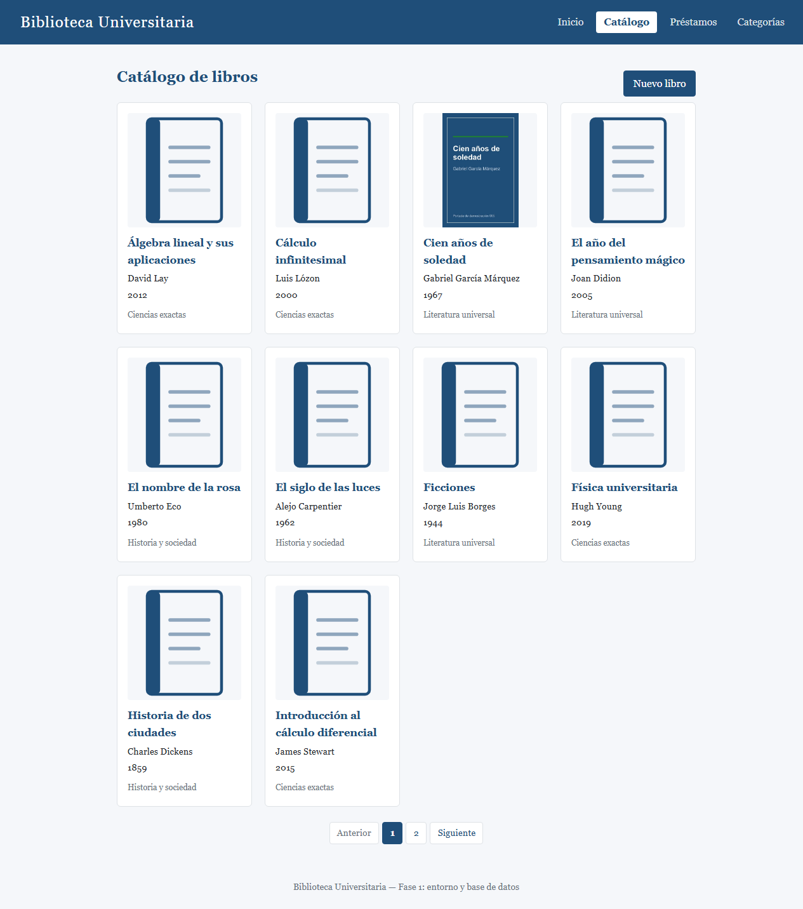 | 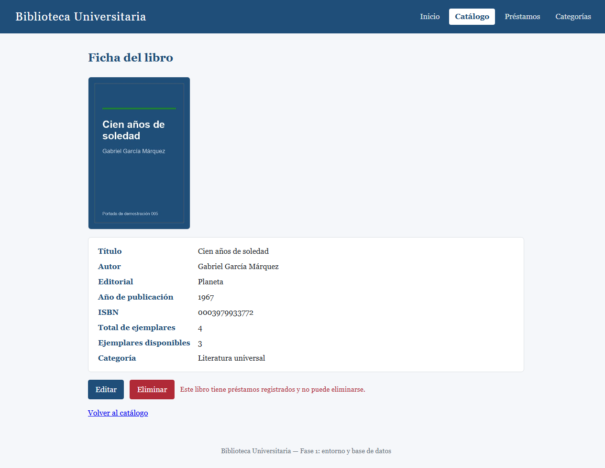 |

| Detalle sin portada (imagen predeterminada) |
|---|
| 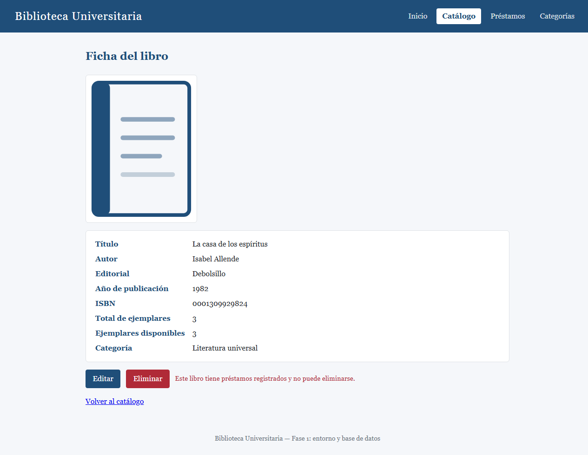 |

## Gestión de préstamos

La aplicación registra préstamos a estudiantes, consulta su historial paginado
y registra las devoluciones. Las reglas de negocio viven en un único servicio
(`app/Services/Prestamos/PrestamoService.php`), la validación en Form
Requests y el controlador es un encargado delgado. Los mensajes de validación
aparecen **junto al campo** y lo escrito se conserva (`old()`).

| Método y ruta | Nombre | Contenido |
|---|---|---|
| `GET /prestamos` | `prestamos.index` | Listado paginado: 10 préstamos por página, orden `fecha_prestamo` DESC → `id` DESC |
| `GET /prestamos/crear` | `prestamos.create` | Formulario de registro (selector de libros, incluidos los agotados; fecha de préstamo por defecto: hoy) |
| `POST /prestamos` | `prestamos.store` | Registro validado |
| `GET /prestamos/{id}/devolver` | `prestamos.form-devolucion` | Formulario de devolución con el resumen del préstamo |
| `POST /prestamos/{id}/devolver` | `prestamos.devolver` | Devolución validada |

### Reglas de préstamo

- **Disponibilidad exacta**: registrar un préstamo descuenta **exactamente un**
  ejemplar disponible; devolverlo lo suma **exactamente una vez**. La
  disponibilidad nunca queda negativa.
- **Sin disponibilidad**: prestar un libro con `disponibles: 0` se rechaza con
  «No hay ejemplares disponibles de este libro.» junto al campo Libro. El
  registro y la devolución son **atómicos** (transacción con bloqueo de fila):
  dos peticiones simultáneas por el último ejemplar no pueden dejar
  disponibilidad negativa.
- **Límite por estudiante**: un carné (comparado sin espacios sobrantes) no
  puede tener más de **tres préstamos sin devolver**; los `vencido` cuentan
  como no devueltos. Tras devolver uno, la plaza liberada vuelve a contar.
- **Estado vencido calculado**: el estado `vencido` se deriva de la fecha (no
  se elige al registrar): un préstamo sin devolver cuya devolución prevista sea
  **estrictamente anterior a hoy** pasa a `vencido` **desde el día siguiente**
  (con prevista = hoy sigue `activo`). La transición se aplica automáticamente
  al registrar, al devolver y al listar, sin intervención manual; los
  préstamos `devuelto` **jamás** cambian de estado.
- **Historial inmutable**: solo existen registrar, consultar y devolver. **No**
  hay rutas `PUT`/`PATCH`/`DELETE` de préstamos ni vistas de edición o
  eliminación: un préstamo ya registrado no puede alterarse salvo por su
  devolución. Un intento con esos verbos responde 404/405.
- **Devolución**: la fecha real es obligatoria y nunca anterior a la fecha de
  préstamo. Repetir la devolución de un préstamo ya `devuelto` se rechaza con
  «Este préstamo ya fue devuelto.» sin volver a sumar ejemplares. Un préstamo
  `vencido` sí puede devolverse con normalidad.

### Capturas de préstamos

| Listado (`/prestamos`) | Registro (`/prestamos/crear`) |
|---|---|
| 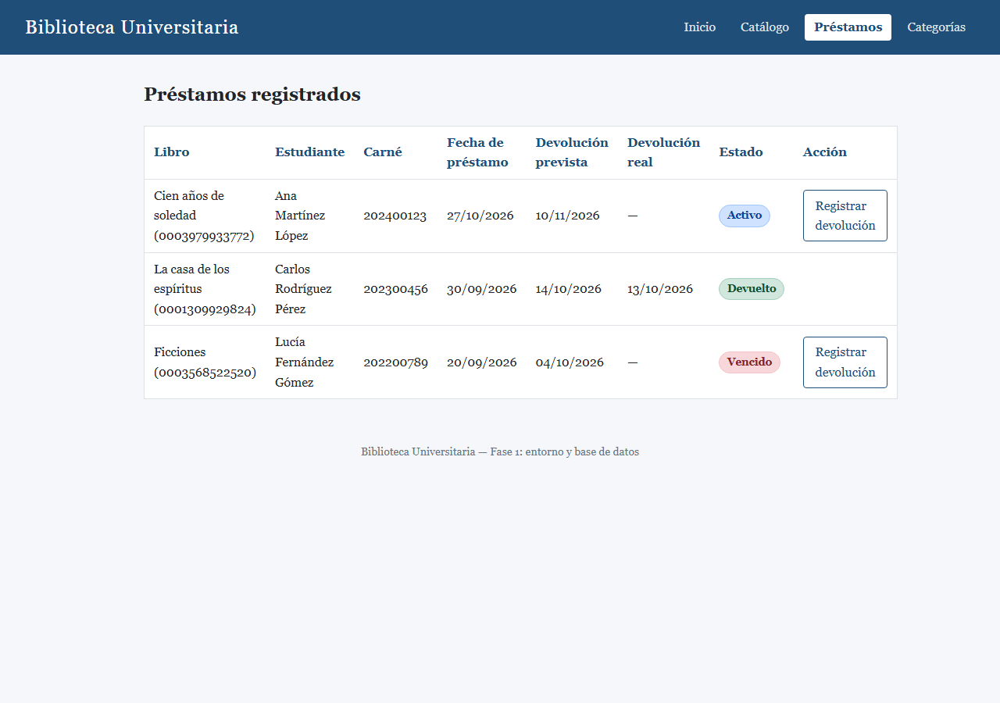 | 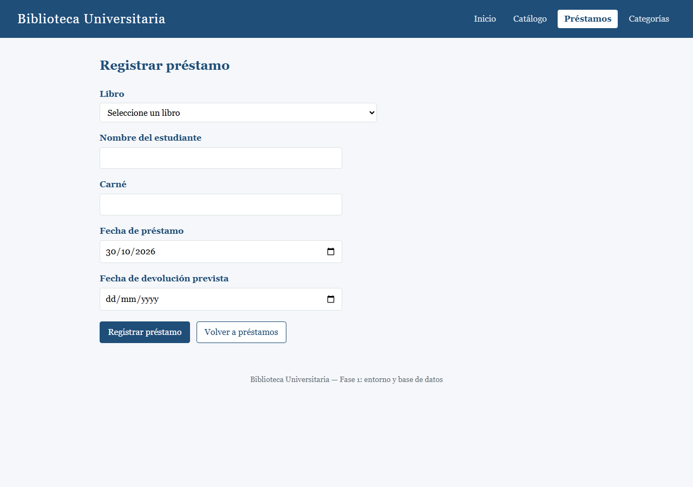 |

| Devolución (`/prestamos/{id}/devolver`) |
|---|
| 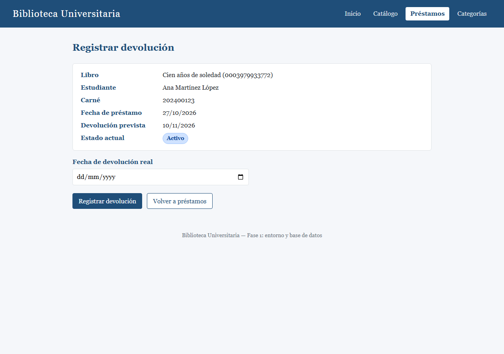 |

## Panel de la biblioteca

La navegación común incluye el enlace **«Panel»**, que abre una única vista de
**solo consulta** en `GET /panel` (nombre de ruta `panel.index`). Requiere sesión
iniciada, no acepta parámetros —la fecha de consulta la fija el servidor— y no
contiene formularios, botones de escritura ni enlaces de eliminación. Muestra
tres indicadores con rótulos y cifras en español:

| Indicador | Regla de cálculo |
|---|---|
| **Libros más prestados** | Los 5 libros con más préstamos del **historial completo** (los devueltos y los vencidos cuentan). Solo aparecen libros con al menos un préstamo. Los empates se resuelven por título —sin distinguir tildes ni mayúsculas— y, si persisten, por ISBN. Cada fila muestra su cifra de préstamos. |
| **Préstamos vencidos** | Préstamos **sin devolución real** cuya devolución prevista es **estrictamente anterior** a la fecha del día (con prevista = hoy **no** vence). Se ordenan por días de retraso de mayor a menor; cada fila muestra libro, estudiante, carné, fecha de préstamo, devolución prevista y días de retraso. Un libro con varios préstamos pendientes aparece en una fila por préstamo. |
| **Ejemplares disponibles por categoría** | Suma de `ejemplares_disponibles` de los libros de cada categoría (nunca `ejemplares_totales`). Se listan las categorías que tienen libros, **incluidas las que tienen 0 disponibles**, y se ocultan las que no tienen ninguno. Orden alfabético español sin distinguir tildes ni mayúsculas: «Álgebra» se ordena como «Algebra». |

Cuando un indicador no tiene datos, su sección muestra exactamente
«**No hay datos disponibles**», sin filas ni relleno artificial. Dos consultas
con los mismos datos devuelven siempre el mismo orden.

El orden alfabético español se fija en la base de datos con la migración de
colación `utf8mb4_0900_ai_ci` sobre `libros.titulo`, `libros.autor` y
`categorias.nombre` (`utf8mb4_unicode_520_ci` en MariaDB). La de
`categorias.nombre` se incorporó con el panel y es la que garantiza que
«Álgebra» preceda a «Arte».

Las reglas de estilo de las tres secciones viven en el propio
`resources/views/panel/index.blade.php` (bloque `<style>`), siguiendo el patrón
de otras vistas del proyecto: reutilizan las variables CSS del layout común y
no añaden frameworks ni dependencias nuevas.

### Captura del panel

| Panel con datos sembrados (`/panel`) |
|---|
| 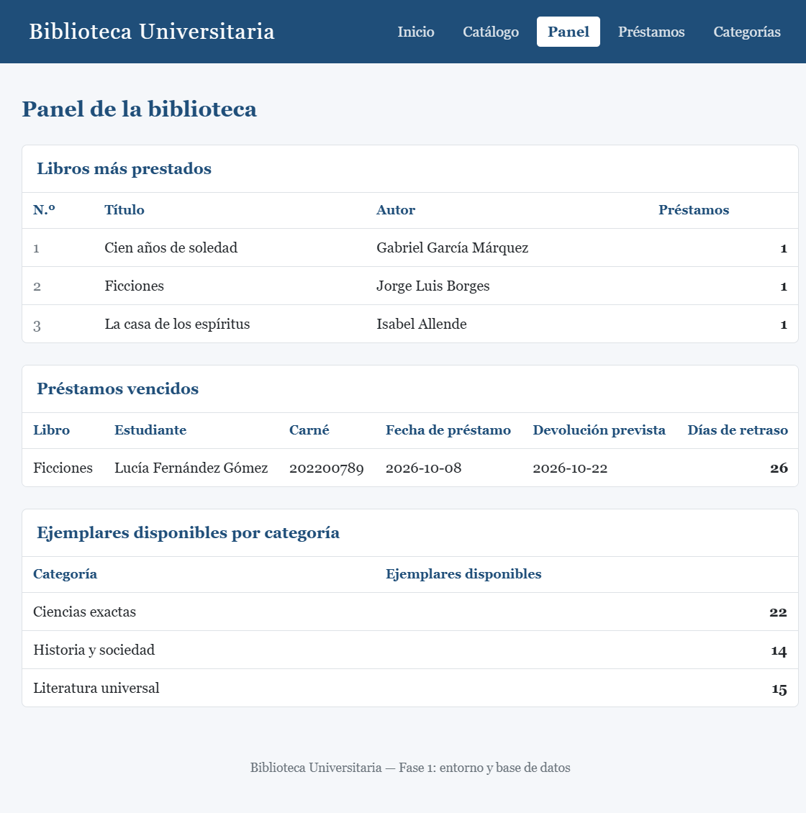 |

## Sistema de diseño

La interfaz (especificación `009-wcag-aaa-ui-redesign`) se construye con **Tailwind CSS 4** y **Vite 8** mediante `laravel-vite-plugin`. Las hojas y scripts se cargan con `@vite` desde `resources/css/app.css` y `resources/js/app.js`:

```bash
npm install
npm run dev      # desarrollo, con recarga en caliente
npm run build    # genera public/build para usar sin el servidor de Vite
```

- **Tokens de color** (`resources/css/app.css`, `:root`): texto, fondo, primario, primario oscuro, secundario, éxito y peligro. El texto normal alcanza **7:1** sobre su fondo real (comprobado en `tests/Feature/ContrasteAaaTest.php`).
- **Tipografía**: familia Instrument Sans (`@theme`, `--font-sans`), servida localmente desde el build.
- **Espaciado y radios**: escala de 4 px con radios de 0,375 rem y 0,5 rem.
- **Foco visible**: contorno de 3 px con desfase de 2 px en `:focus-visible`; nunca se elimina sin sustituto.
- **Componentes**: botón primario y secundario, campo con etiqueta y error, tarjeta de acceso, tabla, alerta, estado vacío, toast de éxito, estado «Cargando…» y aviso de sesión.
- **Estados**: normal, hover, foco, activo, error y deshabilitado, definidos una sola vez en el CSS compartido.
- **Información sin color**: disponibilidad y estados de préstamo se comunican con texto y etiqueta, no solo con color.

### Navegación accesible y puntos de ruptura

- Menús «Gestión» y menú hamburguesa en `<details>`/`<summary>`: funcionan **sin JavaScript**. `resources/js/menus.js` solo añade `aria-expanded`, cierra con `Escape` y devuelve el foco.
- Puntos de ruptura: 360 × 640 px (una columna, hamburguesa), 768 × 1024 px (navegación horizontal) y ≥ 1024 px (diseño de referencia).

### Cumplimiento WCAG 2.1 AAA aplicable

El alcance de cada criterio está en `specs/009-wcag-aaa-ui-redesign/spec.md` (matriz de aplicabilidad). Lo verificado con pruebas automatizadas: contraste 7:1 de la paleta, skip link, navegación nativa sin JavaScript, acciones principales visibles, aviso y extensión de sesión, y validación de portadas en cliente y servidor.

**Resultados de la auditoría** (axe-core 4.14.1 con las etiquetas WCAG 2.0, 2.1 y 2.2 A/AA y AAA, sobre las 8 pantallas × 3 tamaños, 360 × 640, 768 × 1024 y 1280 × 800):

| Comprobación | Resultado |
|---|---|
| Violaciones axe (incluida `color-contrast-enhanced`, AAA) | 0 en 24 combinaciones |
| Desbordamiento horizontal | 0 en 24 combinaciones |
| Enlace para saltar como primer foco; foco visible de 3 px | Cumple |
| Desplegable «Gestión» con Enter; Escape cierra y devuelve el foco | Cumple |
| Aviso de sesión a 5 minutos; «Extender sesión» conserva los datos y muestra el toast | Cumple |
| Toast de éxito oculto a los 6 s | Cumple |
| Rechazo de portada de más de 2 MB en el cliente; archivo válido con resumen | Cumple |
| Sin JavaScript: desplegable nativo y sin aviso de sesión | Cumple |

Las capturas de las 8 pantallas en los tres tamaños están en `public/images/capturas/009/`.

## Verificación

```bash
php artisan migrate:status   # migraciones ejecutadas (100 % «Ran»)
php artisan migrate:fresh --seed   # rehacer el entorno completo
php artisan test             # suite completa (001–008)
```

La suite incluye las nueve pruebas transversales de `008` (`AuthAccesoTest`,
`AuthLoginTest`, `SesionCaducadaTest`, `CsrfProteccionTest`, `EscapadoSalidaTest`,
`EliminacionDeleteTest`, `ValidacionTransversalTest`, `AccesibilidadUiTest` y
`EstadosVaciosTest`). En el entorno de desarrollo queda un fallo heredado y
conocido en `FalloConexionTest` («acceso denegado»): el MySQL local responde el
código `1524` (*plugin `mysql_native_password` not loaded*) en lugar de `1045`,
por lo que el detector de fallos de conexión de `001` no reconoce ese caso.
No es una regresión de `008`; las demás pruebas pasan.

## Diagrama entidad-relación

```text
categorias (1) ──────< (N) libros (1) ──────< (N) prestamos
   nombre UNIQUE           isbn UNIQUE            estado: activo|devuelto|vencido
                         FK categoria_id            FK libro_id → libros
                         → categorias (RESTRICT)    (RESTRICT)
```

- **categorias**: `nombre` único (`varchar(100)`).
- **libros**: `isbn` único de 13 dígitos, ejemplares totales/disponibles,
  `portada` opcional (`NULL` = imagen predeterminada), pertenece a exactamente
  una categoría.
- **prestamos**: estudiante, carnet, fechas de préstamo/devolución prevista y
  real, y estado (`activo`, `devuelto` o `vencido`); pertenece a exactamente un
  libro.
- **users**: `id`, `name`, `email` único, `password` (solo hash) y
  `remember_token`; sin roles ni permisos, únicamente para la sesión.

El esquema se crea **exclusivamente con migraciones** versionadas en
`database/migrations/`; nunca con SQL manual.

Los datos de prueba (`php artisan migrate:fresh --seed`) cargan 3 categorías,
16 libros y 3 préstamos (uno por estado), manteniendo siempre la coherencia
`ejemplares_disponibles = ejemplares_totales − ejemplares en préstamos activos`.

## Eliminación de registros relacionados

La eliminación de un registro con hijos está **bloqueada** mientras existan
registros relacionados (comprobación previa en la aplicación y claves foráneas
`ON DELETE RESTRICT` en la base de datos). El detalle de los avisos y de las
capas de confirmación está en «Eliminaciones con confirmación», más arriba.

## Estructura del proyecto

```text
app/Http/Controllers/   # AuthController, CatalogoController, LibroController, CategoriaController, PrestamoController, PortadaController, PanelController
app/Http/Middleware/    # VerificarInactividad (caducidad de sesión en servidor)
app/Http/Requests/      # LoginRequest, LibroStoreRequest, CategoriaStoreRequest, RegistrarPrestamoRequest…
app/Models/             # Categoría, Libro, Prestamo y User (Eloquent)
app/Services/           # EliminacionService y Prestamos/PrestamoService (reglas de préstamo)
app/Exceptions/         # FalloConexion (aviso en español ante error de BD)
lang/es/                # mensajes de validación y de autenticación en español
database/migrations/    # única fuente del esquema (incluye users)
database/factories/     # datos de prueba deterministas
database/seeders/       # UserSeeder y CatalogoSeeder (3 categorías, 16 libros, 3 préstamos)
resources/views/        # layout común, login, catálogo, libros, categorías, préstamos, panel, parciales y errores
public/css/             # app.css (CSS propio, responsive y accesible; sin frameworks)
public/js/              # app.js (confirmaciones) y busqueda-catalogo.js (debounce nativo, sin build)
tests/Feature/          # nueve suites transversales de 008 + pruebas de 001–007
```
